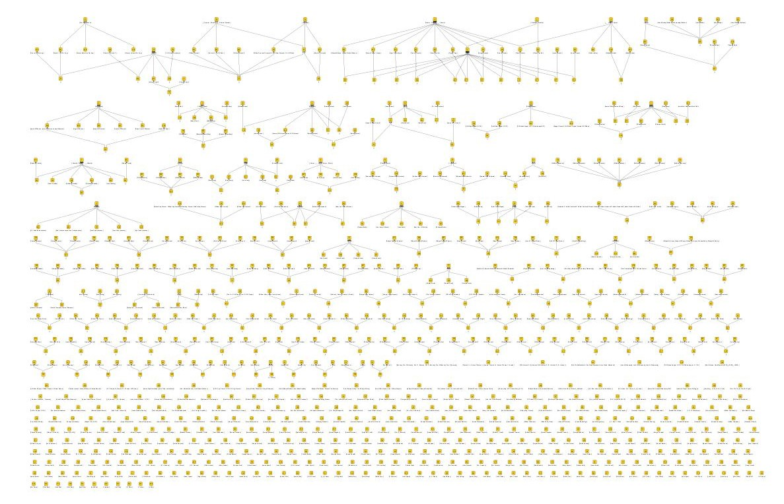
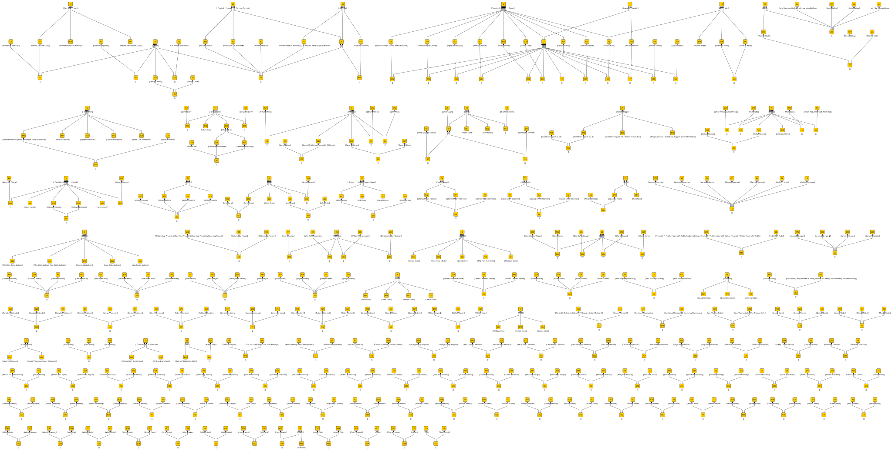
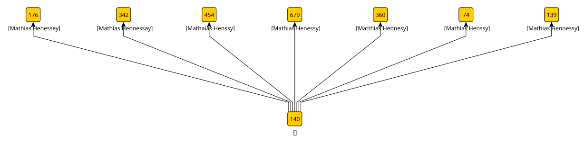

# Multi-agent dialogue

I start with two agents. The first is a **normal** agent that breaks names into tokens on whitespace, removes punctuation characters, and forces the token to lower case.
The seconds is a **soundex** agent that takes the normal tokens and converts them to their equivalent Soundex codes.
I make a "top attributes are people" assumption in each case (see the [WW1 example](https://knoxa.github.io/examples/names/) discussion) and compare the hypotheses:

The disconnected concept nodes at the bottom of the diagram represent agreement between the two agents. Differences of opinion appear as graph clusters above.
Ignoring agreement for the moment, here are the differences as an SVG image:

In this lattice, an object represents a person and its attributes are names.
The attribute labels are visible in the diagram. The object labels aren't immediately visible, but you'll see them if you download the SVG, display it in a web browser, and "mouseover" the concept nodes. Each object label starts with either "S" or "N" according to which agent is asserting that the object represents a person.

To recover a person from this lattice, I find a node that has an object (person) attached, and give it any names you can reach by following the arrows "upwards".
I can rule between the two agents when they disagree,  and action that decision by removing object references from the lattice. For example, here ...

... there is a single **soundex** object at node 140 hypothesizing one person with all 7 names.
The **normal** agent produces 7 objects, one at each of the remaining nodes, hypothesizing 7 different people with 7 different names.
If I delete the **normal** object references, then recover any remaining objects and their attributes, I get just the correct (**soundex**) hypothesis.
I can make similar judgements all over the lattice diagram and recover "truth". See the [WW1 example](https://knoxa.github.io/examples/names/) for more detail on this.

I can also introduce more agents into the dialogue. For example, a **long-s** agent that uses the same tokenization as **normal** with the exception that "s" and "f" are changed to '\*'. This is a generalization of **normal**, which means that names deemed equivalent by **normal** will be subsets of those deemed equivalent by **long-s**.
In cases where two or more **normal** hypotheses are strict subsets of a **long-s** hypothesis, the **long-s** object represents names that are equivalent (if you ignore the long S). I get a set of [long-s hypotheses](hypotheses/long-s.xml).
I'm happy that these hypotheses are true in the sense that equated names really are equivalent, but the person represented by the set has other names too.
I'll say these hypotheses are consistent but not complete. In any further argument I'll claim that sets containing either can be merged.

I can do something similar with an **initials** agent that replaces all but the last token of a name with its first letter.
This time, there are some names are equated when they shouldn't be, so these hypotheses are neither consistent or complete, and I need to make some corrections before I can use them in further arguments.
I don't need to do that straight way though, I can just have some critic agent point out flaws:

	"John Wilson" and "James Wilson" are different people.
	"John Ellis" and "Jospeh Ellis" are different people.

The [initials hypotheses](hypotheses/initials.xml) highlight another problem, that actually comes from the **normal** agent.
Where a name is just a surname, I want it added to sets that have the same surname.
However, there are some names in the dataset that are both surnames and given names.
I have hypotheses where a lone surname is added to sets where it matches a given name, which is wrong.
I can note some more required corrections:

	"Francis", "Francis Cooper", "Francis Crosbie", "Francis Tripp", "Francis Drake", "Francis Agar", "Francis Croster" and "Francis Richard Dickson" are different people.
	"William Thomas" and "William Thomas Taylor" are different people.
	
There's an interesting mistake that's an artifact of the **initials** tokenization. It's caused by ignoring suffixes, so that the last letter of a suffix is interpreted as a surname. This means that "Sir W. Aug. Prevost, K.C.B." becomes `s w a p k c b`, and "Sir William Keppel, K.B." becomes `s w k k b`.
The tokens of the latter are a subset of the token of the former, so the two names get linked.
I could do something cleverer with tokenization to get rounf this, or I could just note another correction:

	"Sir W. Aug. Prevost, K.C.B." and "Sir William Keppel, K.B." are different people.

"William Keppel, K.B." get linked to "Sir W. Aug. Prevost, K.C.B." in the same way, so I also need:

	"Sir W. Aug. Prevost, K.C.B." and "William Keppel, K.B." are different people.

