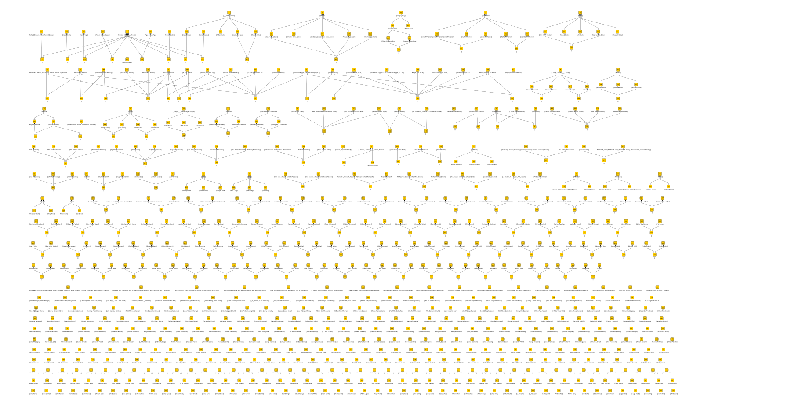

# Multi-agent dialogue

## Hypotheses

The raw data is a set of names.
I want to partition this data so that all the names that belong to the same person are grouped together.
I'll model the process as a dialogue in which agents generate hypotheses, and I evaluate support and contradiction among those hypotheses to produce a consensus.

In this context, a _hypothesis_ is set of names that an agent is claiming belong to a distinct individual person.
I'll call a hypothesis _consistent_ if the names to belong to the same person, and _complete_ if all the names for that person are included in the hypothesis.
A closed world assumption is implied in making this judgement.
I'll call a hypothesis _correct_ if it is both consistent and complete.

Restating the problem, I want to partition the names into correct hypotheses. This is not a strict partition of the input set because different people may share a name.
I'll call a name _ambiguous_ when it may legitimately be associated with more than one hypothesis.

## Dialogue

I start with two agents. The first is the **normal** agent that breaks names into tokens on whitespace, removes punctuation characters, and forces the token to lower case.
I expect this to make good matches but leave a lot of equivalent names unmatched.
The seconds is the **initials** agent that replaces all but the last token of a name with its first letter.
It will make more matches but some of them will be false.

I make a "top attributes are people" assumption in each case (see the [WW1 example](https://knoxa.github.io/examples/names/) discussion) to recover [normal hypotheses](hypotheses/normal.xml) and [initials hypotheses](hypotheses/inititals.xml).
Each `object` in these files represents a person, and each `attribute` a name associated with that person.

I can compare these hypotheses by merging the two files (a disjoint union of the objects) and applying FCA:

Agreement between the two agents is indicated by an object from each occupying the same concept node.
This is most obvious in the disconnected concept nodes at the bottom of the diagram.
The graph clusters above represent disagreement between the agents.
I want to resolve these disagreements.

## Preference

In general, I prefer the results of **initials** to **normal** because they are more likely to be complete.
Objects with larger sets of attributes appear below objects with a subset of their attributes in the the lattice.
I could, naively, take any object that appears at the bottom of the lattice (no incoming arrows) and give it all of the attributes above.
This is reasonable, but carries over some errors that I can address at this point through a more careful analysis of the lattice.

### Complex names

The **initials** agent deals well with name abbreviations and initials.
It falls down when the name has a suffix (so the surname isn't the last token) or when the name is expressed with the surname first.
The result is that it will fail to match names that it would otherwise match if it could parse the name and work out which token was the surname.
I'm happy to ignore this weakness for the time being. Some of these names will be matched by **normal**, which ignores token ordering.
The result is the large cluster of nodes (in the second "row" of the diagram) relating to William Augustus Prevost and William Keppel.

What does concern me at this stage is the link between these two people.
Because **initials** agent has no notion of suffixes, the last letter of a suffix is interpreted as a surname.
This means that "Sir W. Aug. Prevost, K.C.B." becomes `s w a p k c b`, and "Sir William Keppel, K.B." becomes `s w k k b`.
The tokens of the latter are a subset of the token of the former, so the two names get linked.
"William Keppel, K.B." is linked to "Sir W. Aug. Prevost, K.C.B." in the same way.

I can make a **name-check** hypotheses that expresses this. I claim:

	"Sir W. Aug. Prevost, K.C.B." is not the same person as "Sir William Keppel, K.B." or "William Keppel, K.B.".

Ignoring the logic expressed in the sentence, this simply translates into a hypothesis that is a set of three names.
This hypothesis is explicitly incorrect, but it serves as a marker, allowing any **initials** claims that are a superset of it to be discovered and rebutted.

### Ambiguous names

Some of the names in the input data are just surnames.
These are genuinely ambiguous when there is more than one person with the same surname.
In such cases, I want the name added to any sets of names that have the same surname.

However, there are some name tokens in the dataset that are surnames for some people, and given names for others, for example "Francis".
The **normal** agent doesn't take account of token order, so will add a lone surname to any sets that happen to have the same token as either given name or surname.
The **initials** agent does take account of order in that the last token is treated differently from the rest.
A lone surname will only get added to a set of names by **initials** if it matches the last token of the name.

The bottom line is that when **normal** and **initials** clash in this way, I prefer the **initials** hypothesis.
My preferred hypothesis is a strict subset of the rejected hypothesis. For example I want {Francis Cooper, Cooper} and not {Francis, Francis Cooper, Cooper}.
This means that the object for the preferred hypotheses appears above the object for the rejected hypothesis in the diagram.
I can take this account when recovered results from this lattice.

### Same surname and initials

There are straightforward cases where two people have the same surname and initials, but different given name.
I can make some more **name-check** claims:

	"John Wilson" is not the same person as "James Wilson".
	"John Dwyer" is not the same person as "James Dwyer".
	"John Ellis"  is not the same person as "Jospeh Ellis".
	"John Hanna"  is not the same person as "Jospeh Hanna".
	"John Chambers"  is not the same person as "[Serj.] James Chambers".

I can even express uncertainty this way:

	Is "Max Watts" the same person as "Mark Watts"?
	Is "Henry Walker" the same person as "Harry Walker"?

These **uncertain** claims generate hypotheses that may or may not be consistent.
They may be accepted or rejected in follow-on processing according to preference.

### Consistency

At this stage, I want to derive a consistent set of hypotheses from the combined results of **normal** and **initials**.

Just to make it easier to follow what's going on, I'll start by filtering out the agreement between the two agents.
I do this by finding concept nodes in the lattice that have an object from each each.
I make a new object that has all the attributes in this nodes extent.

I can check these [normal-initials agreement](hypotheses/ni-agree.xml) using FCA.
I get discrete concept nodes except where different people have the same surname.
These surnames are legitimately ambiguous. It's simple to recover them from this lattice.

Next, I process the disagreement, with my [corrections](hypotheses/correction.xml) thrown into the mix.
I [edit](editing.md) the resulting FCA lattice to action the corrections and form a new set of hypotheses from the results. 

I can use FCA to assess these new hypotheses.
I get more singleton concepts indicating agreement.
I also get a number of clusters, with two or more concepts feeding into a single concept, where the top concept represents an ambiguous name.
The remaining four clusters are more complex. The simplest two suggest more decisions to make about ambiguity.
They go away if I say:

	"Charles Moore" is not the same person as "Charles Moore Harrison".
	"William Thomas" is not the same person as "William Thomas Tayler".

The remaining two clusters are for William Augustus Prevost and William Keppel, now separated from each other.
The extra structure I see comes from the fact that two people are represented by multiple consistent hypotheses.
I want to merge these consistent hypotheses to make a hypothesis each for Keppel and Prevost.

I could get what I want to be by assuming each cluster represents a person with all the attributes as names, but that's difficult to justify as part a multi-agent dialogue.
Instead, I'll add another agent to the dialogue.

### Identity

Within the limitations of **normal** and **initial**, we can assume that all the hypotheses so far are complete, except for those relating to Prevost and Keppel.
So far, I've been relating and merging hypotheses via name attributes.
If I know that a merged hypotheses is complete, I can assign it an identifier.
I can assign the identifier based on the set of names in the hypotheses.
If I deem two hypotheses to be about the same person, I can assign the same identifier.
I can make this identifier a new attribute on any hypotheses that I identify.

Let's imagine a personalities database and a process that will take the set of names in a hypothesis and search the database for a match.
What'll I'll actually do is add 'PREVOST' as an attribute to any hypothesis that mention Prevost, and a 'KEPPEL' attribute for Keppel.

Now, If I apply FCA, I get 'PREVOST' and 'KEPPEL' concepts at the top of their respective clusters.
I can use the "top concepts are people" assumption to get the [merged hypotheses](hypotheses/ni-consensus.xml) I want.

### Another agent

I now have consistent sets that represent the merged views of **normal** and **initials**.
Transcription errors in surnames will not picked up by these agents, so I turn to a **soundex** agent that converts names to token in the same way as **normal**,
but then translates each token to its Soundex code. Objects are Soundex codes, and attributes are names.

... there is a single **soundex** object at node 140 hypothesizing one person with all 7 names.
The **normal** agent produces 7 objects, one at each of the remaining nodes, hypothesizing 7 different people with 7 different names.
If I delete the **normal** object references, then recover any remaining objects and their attributes, I get just the correct (**soundex**) hypothesis.
I can make similar judgements all over the lattice diagram and recover "truth". See the [WW1 example](https://knoxa.github.io/examples/names/) for more detail on this.

I can also introduce more agents into the dialogue. For example, a **long-s** agent that uses the same tokenization as **normal** with the exception that "s" and "f" are changed to '\*'. This is a generalization of **normal**, which means that names deemed equivalent by **normal** will be subsets of those deemed equivalent by **long-s**.
In cases where two or more **normal** hypotheses are strict subsets of a **long-s** hypothesis, the **long-s** object represents names that are equivalent (if you ignore the long S). I get a set of [long-s hypotheses](hypotheses/long-s.xml).
I'm happy that these hypotheses are true in the sense that equated names really are equivalent, but the person represented by the set has other names too.
I'll say these hypotheses are consistent but not complete. In any further argument I'll claim that sets containing either can be merged.

This time, there are some names are equated when they shouldn't be, so these hypotheses are neither consistent or complete, and I need to make some corrections before I can use them in further arguments.

I don't need to do that straight way though, I can just have some critic agent point out flaws:

The important point is to ensure claims are consistent.
* delete claims that contain inconsistencies, then merge sets that overlap 

