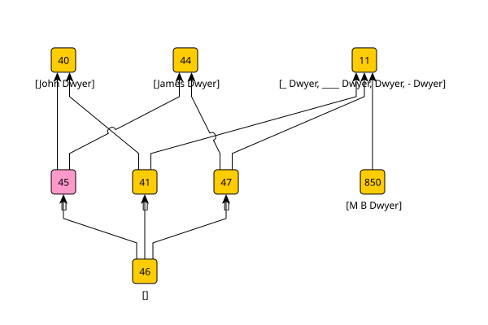

## Jugements on a lattice

I use FCA to create a lattice that compares the hypotheses of two different agents.
Each hypothesis is an object in this lattice, and I can determine (from the object ID or otherwise) which agent made the claim.

Agent hypotheses that completely agree appear at the same concept node in the lattice.
Any conflict between hypotheses separates the concept nodes.

Different agents have different behaviours and capabilities.
I can translate these into preferences between agents when hypotheses conflict.
I can use these preferences to discriminate between agents when extracting an 'agreed' consensus from the lattice.

In line with the discussion [here](dialogue.md), I can merge **normal** and **initials** hypotheses with this assertion:

	"John Dwyer" is not the same person as "James Dwyer".

... and the relevant fragment of the resulting lattice is:

This has **normal** hypotheses at nodes 41 and 46 that separate John Dwyer from James Dwyer, and an **initials** hypothesis at node 46 that (incorrectly) equates them.

I wish to extract hypotheses from this that don't include both John Dwyer and James Dwyer.

Concept node 45, coloured pink, represents my assertion and is an explicitly inconsistent hypothesis.
It is a marker that says that the **initials** hypothesis at node 46 must also be inconsistent because it too equates John Dwyer with James Dwyer.

I want to ignore inconsistent hypotheses when recovering a consensus.
I do this by editing the lattice to remove the objects corresponding to inconsistent hypotheses.
In this case, the objects at nodes 45 and 46.

...

For the case where I prefer **initials** over **normal** I delete **normal** objects pointed to by **initials** nodes.